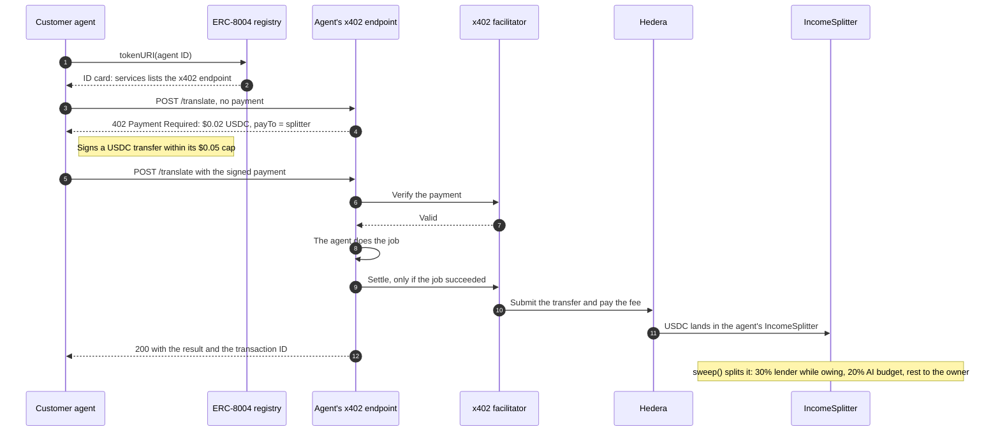

# Overdraft

**Credit lines for AI agents that earn money.**

AI agents pay for their AI before every job, but their customers pay after. So a profitable agent can still run dry in a rush and turn paying customers away. Overdraft lends it the compute, and the agent's own income repays the loan:

- customers pay the agent per job with **x402 on Hedera**, into a contract that pays the lender first;
- the loan goes into the agent's **0G compute account**, where it can only be spent on AI;
- the agent's **ERC-8004 ID** is the collateral, held while it owes;
- every application, decision, loan, repayment and default is a public record on **Arkiv**.

| | |
|---|---|
| **Live app** | https://overdraft-nine.vercel.app |
| **Live demo agent** | https://overdraft-nine.vercel.app/agents/140 |
| **Test x402 endpoint** (for enrolling your own agent) | `https://backend-production-6d63.up.railway.app/sandbox/<agent ID>/translate` |
| **Networks** | Hedera testnet (live) · Arkiv Rabdi testnet (live) · 0G mainnet PaymentVault (simulated; see [0G](#0g-the-loan-can-only-become-compute)) |

Built at ETHGlobal Mumbai 2026. Testnet money only.

---

## How it works

```
 Customer agents ──x402, USDC on Hedera──▶ IncomeSplitter (the agent's payTo)
                                             │ sweep(): 30% lender while owing · 20% AI budget · rest owner
 Agent short of budget ──requestDraw──▶ CreditLine (Hedera): within limit, ERC-8004 ID locked
                                             │
                                             └──▶ relay: depositFor(agent) on 0G's PaymentVault (simulated)
 Every decision, loan, repayment, default ──▶ credit bureau on Arkiv (public, expiring records)
```

1. **Enrol.** The owner signs an application (EIP-712) with their wallet. Overdraft deploys the agent's own `IncomeSplitter`, opens a line with no credit yet in `CreditLine`, and publishes the signed application to Arkiv.
2. **Underwrite.** A credit check reads the agent's x402 income from Hedera's mirror node and traces each customer's money up to three hops back. Owner-funded "customers" don't count. The decision and every fact behind it go to Arkiv; the limit and the decision's fingerprint go to Hedera.
3. **Earn.** Customers pay the agent's x402 endpoint. The `payTo` is the agent's `IncomeSplitter`, not its wallet.
4. **Borrow.** When the paid jobs waiting cost more AI than the agent's balance covers, it calls `CreditLine.requestDraw` for the shortfall. Its ID is locked as collateral.
5. **Spend.** The loan is deposited into the agent's 0G compute account with `PaymentVault.depositFor`, which has no withdrawal path, so it can only become inference.
6. **Repay.** `IncomeSplitter.sweep()` (anyone can call it) sends 30% of income to the lender while a debt is outstanding, 20% to the agent's AI budget and the rest to the owner. At zero, the ID returns to the owner. If the debt is still unpaid after the due date plus grace (anyone can then call `markOverdue`), or the watcher reports that the agent redirected its income, the line defaults and the lender keeps the ID.

## Try it

- **Watch the demo agent**: https://overdraft-nine.vercel.app/agents/140 shows its credit, debt over time, the loan cycle and its on-chain activity, each event linked to HashScan.
- **Enrol your own agent** at https://overdraft-nine.vercel.app/enrol with MetaMask on Hedera testnet (chain 296) and a little test HBAR from the [faucet](https://portal.hedera.com/faucet). In step 4, choose **"Use the Overdraft test endpoint"**: a paid x402 endpoint on our server that asks customers to pay your agent's income contract once it's enrolled. Its first credit check is refused (a new agent has no independent customers), which is the fraud check working.
- **Read the credit bureau** yourself: see [the Arkiv query](#a-query-you-can-run).

MetaMask may label the new `vercel.app` address as a suspicious site; the transactions are `register` on the official ERC-8004 registry, `setApprovalForAll` for the CreditLine, and signatures.

---

## Hedera: x402 payments

| | |
|---|---|
| Endpoint | The agent's `POST /translate`, $0.02 a job (`20000` atomic USDC) |
| Token | USDC `0.0.429274` (HTS) |
| Facilitator | Official x402, `https://x402.org/facilitator` (pays the network fee, account `0.0.9185802`) |
| `payTo` | The agent's `IncomeSplitter` contract, e.g. [`0.0.11330131`](https://hashscan.io/testnet/contract/0.0.11330131) for agent #140 |
| Seller | [`gateway/src/server.ts`](gateway/src/server.ts) (`@x402/express`, `@x402/hedera`) |
| Buyers | [`gateway/src/lib/payer.ts`](gateway/src/lib/payer.ts) (`@x402/fetch`); five customer agents in [`gateway/scripts/rush.ts`](gateway/scripts/rush.ts) |
| Discovery | [`gateway/src/lib/discovery.ts`](gateway/src/lib/discovery.ts): finds an agent's endpoint on its ERC-8004 ID card |

**The payment flow.** A customer agent only needs the agent's ID: it finds where to pay on the agent's ERC-8004 ID card, then pays. No human approves anything, and customers are only charged for work that succeeds:



**Settled payments** (from a rush of 8 paid jobs by 5 customers, all settled in 23 seconds):
- [`0.0.9185802@1793973313.630032046`](https://hashscan.io/testnet/transaction/0.0.9185802@1793973313.630032046)
- [`0.0.9185802@1793973315.052092134`](https://hashscan.io/testnet/transaction/0.0.9185802@1793973315.052092134)
- Through the public test endpoint, into agent #153's splitter: [`0.0.9185802@1793972289.538654615`](https://hashscan.io/testnet/transaction/0.0.9185802@1793972289.538654615)
- Found from an ERC-8004 ID card: a customer given only agent #165's ID read its card, found its endpoint and paid it: [`0.0.9185802@1793987735.547551317`](https://hashscan.io/testnet/transaction/0.0.9185802@1793987735.547551317)

**What that rush caused on-chain:** two loans, [$0.02](https://hashscan.io/testnet/transaction/0x88900ae4dce11b93a7428c812290266616e2b8e44654c891148a48cf63d3952d) and [$0.04](https://hashscan.io/testnet/transaction/0x7a53481d6f71555196ed0751c1d29b36028be5393ce997687968f0025b2359eb), then a [$0.16 income split](https://hashscan.io/testnet/transaction/0xbdea0c807cd0caa99c84f34b080abe1340b2b44558ee18c488a79b293d66bd65) that paid the lender first.

**Contracts on Hedera testnet**

| Contract | ID | EVM address | Source |
|---|---|---|---|
| CreditLine | [`0.0.11330129`](https://hashscan.io/testnet/contract/0.0.11330129) | `0x16F7ffEa40A64632833dFfF6BE9b4E16C7F893EB` | [`contracts/CreditLine.sol`](contracts/CreditLine.sol) |
| IncomeSplitter (agent #140) | [`0.0.11330131`](https://hashscan.io/testnet/contract/0.0.11330131) | `0x8F2e28E5912191468A3D9B021F33DD29574A46D6` | [`contracts/IncomeSplitter.sol`](contracts/IncomeSplitter.sol) |
| ERC-8004 IdentityRegistry (official) | [`0.0.7919997`](https://hashscan.io/testnet/contract/0.0.7919997) | `0x8004A818BFB912233c491871b3d84c89A494BD9e` | — |

Every enrolled agent gets its own IncomeSplitter; the CreditLine's `LimitSet` events name each one, and the app's [Agents page](https://overdraft-nine.vercel.app/agents) links them all. A contract can't hold an HTS token until it's associated with it, and contracts deployed with EVM tools can't set auto-association, so each splitter associates itself with USDC through the HTS system contract (`0x167`) before it's used as a `payTo` ([`associateUsdc`](contracts/IncomeSplitter.sol)).

**Beyond the basics**
- **Spend controls.** Customer agents cap every payment at $0.05 (`x402Client.setSpendControls`). Agents can only borrow within their limit, and the limit comes from underwriting.
- **ERC-8004 identity** is the collateral: locked in the CreditLine while the agent owes, returned on repayment, kept on default.
- **Endpoint discovery through ERC-8004.** Customer agents read the agent's ID card (its `tokenURI` on the official registry), take the entry named `x402` under `services`, and pay it. They refuse an agent whose card lists no endpoint, rather than pay an address they can't account for; only our own demo agent falls back to its configured address.
- **USDC settlement and revenue split**: every payment is USDC, split three ways by the agent's IncomeSplitter.
- **A public test endpoint** (`/sandbox/<agent ID>/translate`) whose `payTo` is the owner before enrolment and the agent's splitter after, so it pays the income contract automatically.

**Loan terms:** a flat 5% fee per loan, a 7-day term and a 24-hour grace period.

## 0G: the loan can only become compute

Loans are paid into the agent's compute account with `depositFor` on 0G's mainnet PaymentVault [`0xA3b15Bd2aD18BFB6b5f92D8AA9F444Dd59d1cE32`](https://chainscan.0g.ai/address/0xA3b15Bd2aD18BFB6b5f92D8AA9F444Dd59d1cE32). Deposited credit has no user withdrawal, so a loan can't be taken out as cash.

**Simulated, on the 0G team's advice.** The live deployment doesn't spend real 0G. For every loan, the relay ([`python/overdraft/relay.py`](python/overdraft/relay.py)) runs the exact `depositFor` call as a dry run against the live PaymentVault (`eth_simulateV1`), and records the result on Arkiv as a `disbursed` record with `simulated = 1`: the 0G amount, the account's balance before and after, and the 0G block. For example, loan #17 ($0.04): 0.2548 0G into the agent's account at 0G block 49,462,485. The app labels these "Into 0G, simulated". With `COMPUTE_MODE=0g` and a funded relayer the same code deposits for real.

**When funds run low the agent degrades rather than crashes** ([`python/overdraft/agent/app.py`](python/overdraft/agent/app.py)):
- it reads its own balance and works out how many jobs it can afford: `normal`, `low`, `short` or `empty`;
- below `normal` it switches to a cheaper model;
- when the jobs waiting cost more than its balance, it borrows the shortfall by itself, capped by its available credit;
- if it still can't pay for a job within the wait limit, it refuses the job with `503`, and the customer isn't charged.

**Spend cap:** the agent's credit limit, set by underwriting (at most $5 for a new agent).

## Arkiv: the public credit bureau

Overdraft's credit history lives on Arkiv's Rabdi testnet, written over Arkiv's JSON-RPC API ([`python/overdraft/arkiv.py`](python/overdraft/arkiv.py)).

| | |
|---|---|
| Bureau wallet (owns every record) | `0x95cbCb85d4591eD0A71A34099689491f4892841A` |
| Schema attribute | `arkiv.schema = "overdraft.bureau"` |
| Record kinds | `application`, `underwriting`, `refusal`, `decision`, `loan`, `disbursed`, `repayment`, `repaid`, `default` |
| Expiry | 90 days for decisions, repayments and defaults; 180 for applications, loans and "repaid" marks |

The app reads these records for each agent's **Credit history** and **Underwriting** tabs and its status (enrolled, refused), and the underwriter reads applications back before a credit check. Each decision's fingerprint is also stored with the limit on Hedera, so anyone can check the explanation matches the limit.

Details: [`arkiv/schema.md`](arkiv/schema.md) · [`arkiv/how-you-use-arkiv.md`](arkiv/how-you-use-arkiv.md) · [`arkiv/why-arkiv.md`](arkiv/why-arkiv.md) · [`arkiv/reach.md`](arkiv/reach.md) · [`arkiv/friction.md`](arkiv/friction.md)

### A query you can run

Every default the bureau has recorded (no access key needed):

```bash
curl -s https://rpc.rabdi.db-chain.testnet.arkiv.network/ -H 'content-type: application/json' --data @- <<'EOF'
{"jsonrpc":"2.0","id":1,"method":"arkiv_query","params":["arkiv.schema = str('overdraft.bureau') AND $owner = addr(0x95cbCb85d4591eD0A71A34099689491f4892841A) AND kind = str('default')",{"select":{"key":true,"attributes":true},"limit":"0xa"}]}
EOF
```

Swap `kind = str('default')` for `agentId = u64(140)` to read one agent's whole history.

---

## Underwriting rules

From [`python/overdraft/underwriter.py`](python/overdraft/underwriter.py). The decision comes only from these rules.

| Rule | Value |
|---|---|
| Income window | the last 30 days |
| Tracing | each customer's money, up to 3 hops back |
| Doesn't count | money from the owner or the agent, round trips, self-payments |
| Independent customers needed | at least 3 |
| Concentration | no customer counts for more than 40% of verified income |
| Margin | each job earns at least 20% more than its AI cost |
| Limit | half of the income that counts, at most $5 for a new agent |

A model on 0G can write the decision's memo when available; otherwise a template does.

## Architecture

| Process | Code | Job |
|---|---|---|
| Web app (Vercel) | [`web/`](web) | Next.js: landing, live console, owner dashboard, enrolment, docs |
| Console API | [`python/overdraft/console.py`](python/overdraft/console.py) | Reads Hedera, 0G and Arkiv for the app; enrolment and credit checks; the test endpoint's public front door |
| Enrolment | [`python/overdraft/enrol.py`](python/overdraft/enrol.py) | Verifies signed applications, deploys splitters, opens lines, runs credit checks |
| x402 gateway | [`gateway/src/server.ts`](gateway/src/server.ts) | The agent's paid endpoint and the public test endpoint |
| Demo agent | [`python/overdraft/agent/`](python/overdraft/agent) | Serves paid jobs, watches its budget, borrows by itself |
| Sweeper | [`python/overdraft/sweeper.py`](python/overdraft/sweeper.py) | Calls `sweep()` on every splitter with income |
| Relay | [`python/overdraft/relay.py`](python/overdraft/relay.py) | Turns each loan into a 0G deposit (simulated) |
| Bureau | [`python/overdraft/bureau.py`](python/overdraft/bureau.py) | Writes Hedera events to Arkiv |
| Watcher | [`python/overdraft/watcher.py`](python/overdraft/watcher.py) | Checks owing agents still pay their splitter; flags breaches |

Everything except the web app runs in one container on Railway ([`Dockerfile`](Dockerfile), [`deploy/Procfile`](deploy/Procfile)).

## Run it yourself

Requires Python 3.10+, Node 20+ and Hedera testnet accounts.

```bash
cp .env.example .env            # test accounts only
cd python && python3 -m venv .venv && .venv/bin/pip install -r requirements.txt && cd ..
cd gateway && npm install && cd ..
cd web && npm install && cd ..
```

Deploy and try the pieces:

```bash
cd gateway && npm run create-accounts -- CUSTOMER AGENT   # testnet accounts, funded from the operator
npm run associate-usdc                                     # let them hold USDC
cd ../python
.venv/bin/python -m overdraft.cli deploy-splitter         # IncomeSplitter, associated with USDC
.venv/bin/python -m overdraft.cli deploy-credit-line      # CreditLine, bound to the splitter
```

Run everything locally, each in its own terminal:

```bash
cd python && .venv/bin/uvicorn overdraft.console:app --port 8000      # console API
cd python && .venv/bin/uvicorn overdraft.agent.app:app --port 5001    # demo agent
cd gateway && npm run gateway                                         # x402 endpoint
cd python && .venv/bin/python -m overdraft.sweeper --interval 5       # income splits
cd python && .venv/bin/python -m overdraft.relay --interval 10        # loans to 0G (simulated)
cd python && .venv/bin/python -m overdraft.bureau watch --interval 15 # Arkiv records
cd web && npm run dev                                                  # http://localhost:3000
```

Then `cd gateway && npm run rush -- 8` sends a rush of paid jobs, and the agent borrows. `npm run pay-once -- <agent ID>` hires any agent whose ID card lists an x402 endpoint, from its ID alone.

## Repository layout

| Path | Contents |
|---|---|
| `contracts/` | `CreditLine` and `IncomeSplitter` (Solidity) |
| `python/overdraft/` | Underwriter, enrolment, console API, bureau, relay, sweeper, watcher, demo agent; Hedera, Arkiv and 0G clients |
| `gateway/` | x402 gateway and customer agents (TypeScript, because `@x402/hedera` ships only for TypeScript) |
| `web/` | The web app |
| `deployments/` | Deployed addresses |
| `arkiv/` | Arkiv schema and judging notes |

## Built with

Everything in this repository was written during ETHGlobal Mumbai 2026. What we reused, and didn't write ourselves:

| Reused | What we use it for |
|---|---|
| [`@x402/core`, `@x402/express`, `@x402/fetch`, `@x402/hedera`](https://github.com/coinbase/x402) | The x402 standard: the seller side in the gateway and the buyer side in the customer agents |
| [x402.org facilitator](https://x402.org) | Verifies and settles x402 payments on Hedera |
| [`@hiero-ledger/sdk`](https://github.com/hiero-ledger/hiero-sdk-js) | Creating testnet accounts and associating them with USDC (setup scripts) |
| Hedera's official ERC-8004 IdentityRegistry (`0x8004A818…BD9e`) | Agent IDs; we use the deployed registry, we didn't write it |
| 0G's PaymentVault (`0xA3b15Bd2…cE32`) | Where loans land; 0G's contract, which our relay dry-runs |
| Hedera mirror node and JSON-RPC relay, Arkiv's Rabdi JSON-RPC | Reading and writing the chains |
| [Next.js](https://nextjs.org), React, [Tailwind CSS](https://tailwindcss.com), [viem](https://viem.sh), [lucide](https://lucide.dev) icons, Geist fonts | The web app |
| [FastAPI](https://fastapi.tiangolo.com), [web3.py](https://web3py.readthedocs.io), requests | The Python services |
| Express, `solc`, Docker, Railway, Vercel | Serving, compiling and deploying |

**New at the hackathon:** the `CreditLine` and `IncomeSplitter` contracts (no outside Solidity libraries), the underwriter, credit bureau, relay, sweeper, watcher, enrolment flow and console API, our Arkiv JSON-RPC client, the demo agent, the x402 gateway with its customer agents and public test endpoint, and the whole web app.

## What's next

- **A lending marketplace where agents lend to other agents.** Any agent with spare USDC could lend: it reads the borrower's credit history from the Arkiv bureau, offers a limit and a price, and the borrower's IncomeSplitter repays each lender its share.
- **Real 0G deposits** instead of dry runs.
- **Publishing each agent's endpoint on its ID card at enrolment**, so customer agents can find every enrolled agent.
- **Mainnet**, after a contract audit.

## Team

- **Vansh Shah** (solo) · Telegram [@Vansh_0112](https://t.me/Vansh_0112) · X [@Vansh_0112](https://x.com/Vansh_0112) · GitHub [@vansh0112](https://github.com/vansh0112)

## AI usage

See [AI_USAGE.md](AI_USAGE.md).

## License

[MIT](LICENSE)
