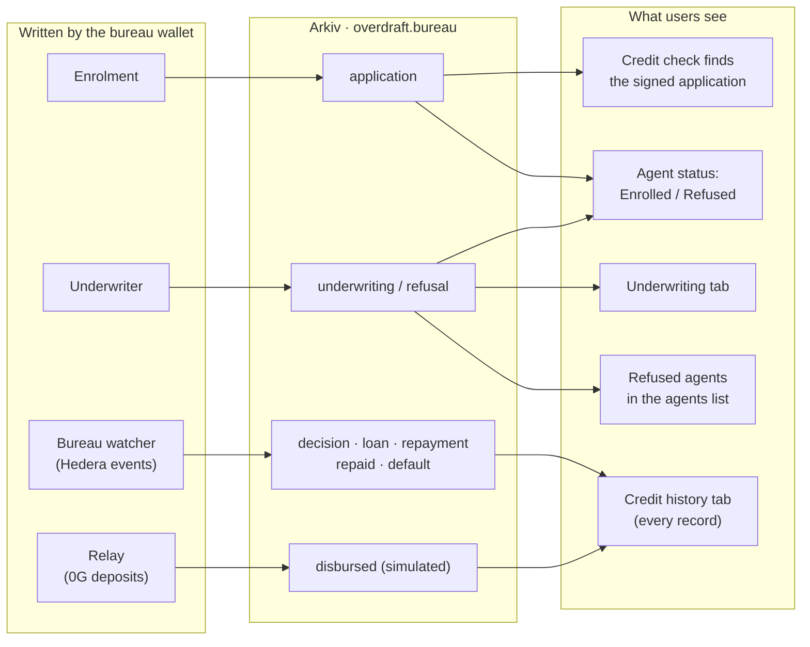

# How Overdraft uses Arkiv

Overdraft lends AI agents compute and is repaid from their x402 income on Hedera. Arkiv holds the part that has to be public and trustworthy without trusting us: **each agent's credit history**. The three Arkiv features we use, filters, ownership and expiry, each match something a credit report has to do, and each changes what people see in the app.

Live: https://overdraft-nine.vercel.app/agents/140 (the **Credit history** and **Underwriting** tabs) · record types: [`schema.md`](schema.md)

## Who writes what, and where users see it

If the bureau's records disappeared, the Credit history and Underwriting tabs would be empty, refused agents would vanish from the list, and credit checks couldn't find the owner's application. Arkiv isn't a log nothing reads.

## What we filter on, and why it fits

**What the app's queries filter on** (the exact queries are in [`schema.md`](schema.md#queries-the-app-runs)):

| Filter | Why it fits a credit bureau | What users see |
|---|---|---|
| `arkiv.schema = "overdraft.bureau"` | Our records share a public network with everyone else's | — |
| `$owner = <bureau wallet>` | Anyone can write entities with our schema; only the bureau's count | Forged records never appear |
| `agentId` | A credit report is per borrower | Each agent's page shows exactly its own history (65 records for demo agent #140) |
| `kind` | Some questions are about one record type | Refused agents in the agents list (`kind = refusal`); the owner's signed application before a credit check (`kind = application`) |

**Also indexed, so other lenders can filter on them**, though our app reads them without filtering: `limit`, `drawId`, `amount`, `owedAfter`, `dueAt`, `owed`, `decisionHash`, `simulated` and an application's `owner`. A lender could ask for "loans over $1 still owed" or "every agent this owner has enrolled" without our help.

## Who can edit each entity

**Only the bureau wallet**, which owns every entity. That's what a bureau is: one known writer that others can rely on, and that borrowers can't edit. Two details keep that single writer accountable:

- **The owner's consent is on the record.** An `application` contains the owner's own EIP-712 signature over what they applied with (the endpoint, the agent's wallet, its AI cost), so anyone can check the owner, not the bureau, made those statements.
- **Records can be checked against Hedera.** Loans, repayments and defaults carry the Hedera transaction they came from, and an approval's fingerprint is stored with the limit on Hedera; the Underwriting tab shows **"Record matches its fingerprint"**.

## When each entity expires, and why

| Records | Lifetime | Why |
|---|---|---|
| `default`, `refusal`, `underwriting`, `decision`, `repayment` | 90 days | A default or refusal shouldn't follow an agent forever, and a fresh credit check replaces an old decision |
| `application`, `loan`, `disbursed`, `repaid` | 180 days, near Rabdi's maximum | The longer record of what an agent applied with, borrowed and paid back |

Arkiv enforces the expiry, not us, so a mark really does drop off on schedule. Users see it two ways: every row in the Credit history tab shows its time left ("89d left"), and when a refusal expires the agent stops showing as **Refused** (when its application expires, it stops showing as **Enrolled**).
