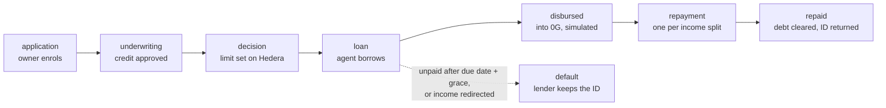
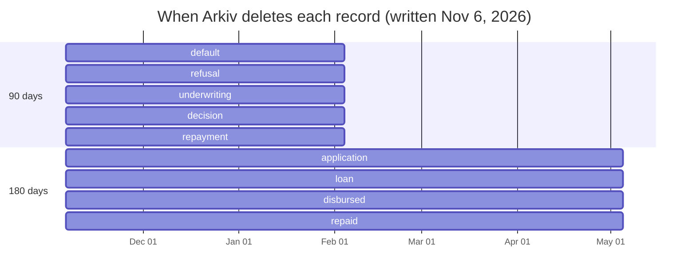

# Arkiv schema: the Overdraft credit bureau

Overdraft keeps a public credit history for AI agents on Arkiv's **Rabdi testnet** (`https://rpc.rabdi.db-chain.testnet.arkiv.network`). Every record is one entity.

- **Owner:** every entity is created by, and owned by, the **bureau wallet** `0x95cbCb85d4591eD0A71A34099689491f4892841A`. Only it can change or delete them, and every reader filters on it.
- **Namespace:** every entity carries `arkiv.schema = "overdraft.bureau"`.
- **Written by:** [`python/overdraft/bureau.py`](../python/overdraft/bureau.py) (events from Hedera), [`underwriter.py`](../python/overdraft/underwriter.py) (credit decisions), [`applications.py`](../python/overdraft/applications.py) (enrolments) and [`relay.py`](../python/overdraft/relay.py) (0G deposits), through our JSON-RPC client [`arkiv.py`](../python/overdraft/arkiv.py).

As of Nov 6, 2026 the bureau holds **127 entities about 11 agents**: 36 `decision`, 35 `loan`, 29 `repayment`, 7 `underwriting`, 6 `application`, 4 `repaid`, 4 `default`, 3 `refusal`, 3 `disbursed`.

## Attributes on every entity

| Attribute | Type | Indexed | Meaning |
|---|---|---|---|
| `arkiv.schema` | str | yes | Always `overdraft.bureau` |
| `kind` | str | yes | The record type (below) |
| `agentId` | u64 | yes | The agent's ERC-8004 ID |

Indexed attributes can be filtered on in queries; the others are stored and returned, but not filtered.

## Record types

| `kind` | Written when | Indexed (filterable) | Stored | Expires after |
|---|---|---|---|---|
| `application` | An owner enrols an agent | `owner` (addr), `decisionHash` (str: the application's fingerprint) | `record` (bytes): the owner's signed EIP-712 application, its x402 terms and the new splitter | 180 days |
| `underwriting` | A credit check approves | `limit` (u64, USDC atomic), `decisionHash` (str) | `record` (bytes): every fact the rules used (customers, money trails, verdicts), the memo and who wrote it | 90 days |
| `refusal` | A credit check refuses | `limit` (0), `decisionHash` | `record`, as above, with the reasons | 90 days |
| `decision` | A limit is set on Hedera (`LimitSet`) | `limit` | `agent`, `owner`, `zgAccount` (addr), `decisionHash`, `hederaTx` | 90 days |
| `loan` | The agent borrows (`DrawRequested`) | `drawId`, `amount`, `owedAfter`, `dueAt` (u64) | `zgAccount`, `hederaTx` | 180 days |
| `disbursed` | A loan is deposited on 0G | `drawId`; `simulated` (u64, 1) for dry runs | `amount0G`, `balanceBefore0G`, `balanceAfter0G`, `zgAccount`, `vault`, `creditLine`, `at`, `zgBlock`; or `zgTx` for a real deposit | 180 days |
| `repayment` | Income pays the lender (`Swept`) | `amount`, `owedAfter` | `hederaTx` | 90 days |
| `repaid` | The debt reaches zero and the ID is returned (`IdReleased`) | — | `hederaTx` | 180 days |
| `default` | A line defaults (`Defaulted`) | `owed` | `reason` (str), `hederaTx` | 90 days |

Amounts are USDC in atomic units (6 decimals): `20000` is $0.02. Lifetimes are set in blocks (43,200 a day at 2 seconds a block); Rabdi's maximum is about 182 days.

## One loan's life on Arkiv

Each step of a loan adds a record, all owned by the bureau wallet:



And each record deletes itself on its own schedule. For records written on Nov 6, 2026:



## The link to Hedera

`decisionHash` ties the records together across both networks. The fingerprint of an approved `underwriting` record (or of the `application`, while a line has no credit yet) is stored with the agent's limit in the CreditLine contract on Hedera. The app recomputes it from the record and shows whether they match, so a reader can tell that the explanation on Arkiv is the one behind the limit on Hedera.

## Queries the app runs

| Used for | Condition |
|---|---|
| An agent's credit history (the Credit history and Underwriting tabs) | `arkiv.schema = str('overdraft.bureau') AND $owner = addr(<bureau>) AND agentId = u64(<id>)` |
| Every enrolment, to find an agent's latest application before a credit check | `arkiv.schema = str('overdraft.bureau') AND $owner = addr(<bureau>) AND kind = str('application')` |
| Refused agents, for the agents list | `arkiv.schema = str('overdraft.bureau') AND $owner = addr(<bureau>) AND kind = str('refusal')` |

## Try it

Every default the bureau has recorded (no key needed):

```bash
curl -s https://rpc.rabdi.db-chain.testnet.arkiv.network/ -H 'content-type: application/json' --data @- <<'EOF'
{"jsonrpc":"2.0","id":1,"method":"arkiv_query","params":["arkiv.schema = str('overdraft.bureau') AND $owner = addr(0x95cbCb85d4591eD0A71A34099689491f4892841A) AND kind = str('default')",{"select":{"key":true,"attributes":true,"expiresAt":true},"limit":"0xa"}]}
EOF
```
